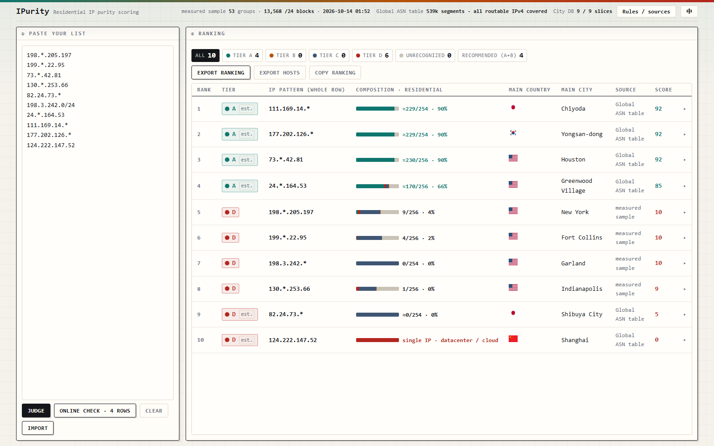

<div align="center">


# iPurity

**A web tool that batch-checks residential IPs.**

[](LICENSE)   

**[Live site](https://ipurity.pages.dev)** &nbsp;·&nbsp; **[Scoring rules](docs/judging-criteria.md)** &nbsp;·&nbsp; **[Data refresh](docs/data-pipeline.md)** &nbsp;·&nbsp; [中文](README.md) · **English**



</div>

## When you need it

Subscribing to AI services, running a cross-border e-commerce shop, running TikTok and other social accounts —
the first thing a risk engine looks at is whether the IP is a residential line or a datacenter. Paste your whole
candidate list and see which of them are residential.

## Scoring rules

The tool only reads IPs: country, city and notes in your list are ignored, and country and city are looked up by
the tool itself. A row with `*` is expanded into 256 ranges (254 when the `*` is in the 4th octet), each one is
classified, and the whole row is then placed in one of four tiers by its residential share:

| Tier | Meaning | Residential share |
| :-- | :-- | :-- |
| **A** | mostly residential | ≥ 58.6% |
| **B** | residential and business | 23.4% – 58.5% |
| **C** | mostly business and institutional | 7.8% – 23.3% |
| **D** | mostly datacenter and institutional | < 7.8% |

A tier marked `est.` is inferred from the IP owner table and is an upper bound only: that table cannot see
the datacenter ranges rented out inside a large carrier, so the residential share is capped at 90%. The full
criteria, the calibration, and what online IP lookup sites actually report are in
[Scoring rules](docs/judging-criteria.md) (Chinese).

It answers one question: which of these IP ranges are residential. If your IPs are all datacenter, or you only
want the city a single IP sits in, it will not help you.

## Data sources

| Data | Source | Coverage | Refresh |
| :-- | :-- | :-- | :-- |
| **Measured records** | ip-api.com free endpoint, one look-up per range | 53 groups, 13,568 ranges | manual |
| **IP owner table** | iptoasn + PeeringDB + bad-asn-list | 539k entries, every in-use IP | daily |
| **City data** | DB-IP City Lite (CC BY 4.0) | 3.62M entries, 33 MB, loaded file by file as needed | monthly |
| **Calibration** | residential share per ASN, inferred from the measured records | 291 ASNs | with the IP owner table |

The data files ship with the repository (see `data/`). The scheduled jobs in `.github/workflows/` refresh the
ASN layer daily and the city layer monthly, and commit only once the upstream data has actually changed and the
self-checks pass. Manual commands and file formats are in [Data refresh](docs/data-pipeline.md) (Chinese).

## Privacy

Nothing you paste is uploaded. Grading runs entirely in your browser and only reads this site's own data files:
there is no backend, no analytics and no cookies, and what you paste stays in your browser's localStorage.

Requests go out only when you click **Online check** or **Run live lookup**, and only for a few sampled IPs,
never for the whole list. The sites involved are `ipwho.is`, `ip-api.com`, `rdap.org`, Cloudflare's and
Google's DoH (for PTR and Team Cymru lookups), `stat.ripe.net` and `internetdb.shodan.io`. Anything a source
does not answer is recorded as “not retrieved” rather than guessed. Flag icons come from `flagcdn.com`, and
those requests carry no referrer.

## Contributing

Serve the repository over HTTP to work on it locally (`file://` URLs are blocked from loading the data files):

```powershell
python -m http.server 8080                          # open http://localhost:8080/
node tools/query.mjs "130.*.253.66" "82.24.73.*"    # command-line lookup
```

- Run `node test/run-all.mjs` before opening a pull request; the checks cover page wiring, judging consistency
  and the Chinese/English entries.
- If you disagree with a rule or a data source, open an issue and say which row and which verdict.
- After changing `assets/*.js`, `data/*` or `index.html`, run `node tools/bump-build.mjs` to update the build
  stamp. Script and data URLs carry `?v=<build>`, and a stale stamp means new HTML with old JS.

If this tool is useful to you, [a ⭐](https://github.com/dawenbin/ipurity) helps others find it.

<a href="https://star-history.com/#dawenbin/ipurity&Date">
  <picture>
    <source media="(prefers-color-scheme: dark)" srcset="https://api.star-history.com/svg?repos=dawenbin/ipurity&type=Date&theme=dark">
    
  </picture>
</a>

## License

Licensed under [Apache-2.0](LICENSE). Third-party data sources and attribution are listed in [NOTICE](NOTICE);
the city data comes from DB-IP (CC BY 4.0), so please keep the attribution when redistributing.
