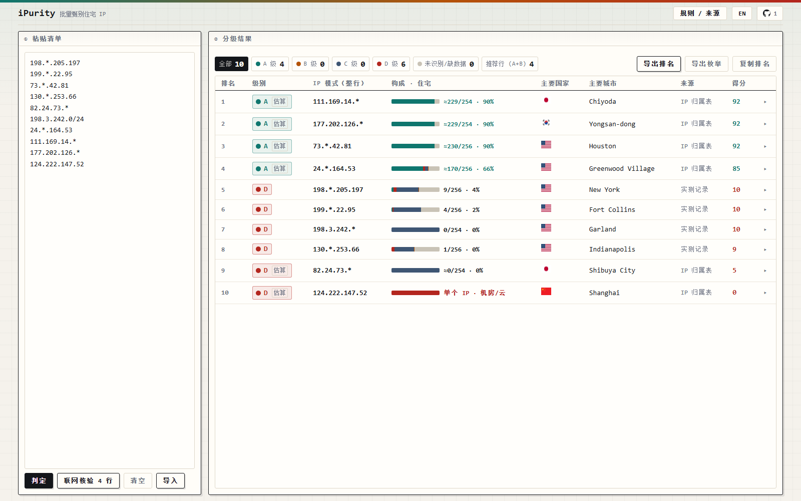

<div align="center">


# iPurity

**批量甄别住宅 IP**

[](LICENSE)   

**[在线使用](https://ipurity.pages.dev)** &nbsp;·&nbsp; **[判定口径](docs/judging-criteria.md)** &nbsp;·&nbsp; **[数据更新](docs/data-pipeline.md)** &nbsp;·&nbsp; **中文** · [English](README.en.md)



</div>

## 应用场景

订阅 AI 服务、开跨境电商店铺、运营 TikTok 和社媒多账号时，也许你需要**批量甄别住宅 IP。**

## 判定口径

工具只看 IP：清单里写的国家、城市、备注一律不看，国家和城市由它自己查。带 `*` 的一行会被展开成 256 个网段（`*` 在第 4 段时为 254 个），逐个判断，再按住宅占比定级：

| 级别 | 含义 | 住宅占比 |
| :-- | :-- | :-- |
| **A** | 住宅为主 | ≥ 58.6% |
| **B** | 住宅与商业混合 | 23.4% – 58.5% |
| **C** | 商业、机构为主 | 7.8% – 23.3% |
| **D** | 机房、机构为主 | < 7.8% |

级别后面标着「估算」的，是按 IP 归属表推算出来的，只能算上限：归属表看不到大运营商内部转租出去的机房段，所以住宅占比最高按 90% 计。判据细节、标定原理，以及各类在线查 IP 网站究竟在算什么，见 [判定口径](docs/judging-criteria.md)。

它只回答一个问题：这些 IP 段里，哪些属于住宅 IP。如果你的 IP 全部属于机房，或者只想查单个 IP 落在哪座城市，它帮不上忙。

## 数据来源

| 数据 | 来源 | 覆盖范围 | 更新频率 |
| :-- | :-- | :-- | :-- |
| **实测记录** | ip-api.com 免费接口，逐个网段实测 | 53 组，13,568 个网段 | 手动 |
| **IP 归属表** | iptoasn + PeeringDB + bad-asn-list | 53.9 万条，网上在用的 IP 全收录 | 每天 |
| **城市数据** | DB-IP City Lite（CC BY 4.0） | 362 万条，33 MB，用到哪份才加载哪份 | 每月 |
| **标定库** | 用实测记录反推每个 ASN 的住宅占比 | 291 个 ASN | 随 IP 归属表 |

数据包随仓库一起发布（见 `data/`）。`.github/workflows/` 里的定时任务每天刷新 ASN 层、每月刷新城市层，只有上游数据真的变了、自检也通过，才会提交。手工更新的命令与数据格式见 [数据更新](docs/data-pipeline.md)。

## 隐私

粘贴的清单不会被上传。判定完全在浏览器里完成，只读取本站自己的数据文件，没有后端、没有统计代码、没有 Cookie，粘贴内容只存在你自己浏览器的 localStorage 里。

只有点击「联网核验」或「实测取证」时才会发请求，而且只发抽样出来的少数几个 IP，不会发整张清单。涉及的站点有 `ipwho.is`、`ip-api.com`、`rdap.org`、Cloudflare 与 Google 的 DoH（用来查 PTR 和 Team Cymru）、`stat.ripe.net`、`internetdb.shodan.io`。查不到就如实标注「未获取」，不编造数字。国旗图标来自 `flagcdn.com`，请求不带 referrer。

## 参与开发

在本地起一个静态服务即可调试（用 `file://` 打开时，浏览器会拦住数据文件）：

```powershell
python -m http.server 8080                          # 打开 http://localhost:8080/
node tools/query.mjs "130.*.253.66" "82.24.73.*"    # 命令行查询
```

- 提交 PR 前先跑 `node test/run-all.mjs`，自检覆盖页面接线、判定一致性和中英文词条。
- 对判定口径或数据来源有异议，欢迎开 issue，请说明是哪一行的哪个结论。
- 改过 `assets/*.js`、`data/*` 或 `index.html` 之后，跑 `node tools/bump-build.mjs` 更新构建戳。脚本和数据包的 URL 都带 `?v=<build>`，不更新会变成「新 HTML 配旧 JS」。

如果这个工具对你有帮助，[点个 ⭐](https://github.com/dawenbin/ipurity) 可以让更多人看到它。

<a href="https://star-history.com/#dawenbin/ipurity&Date">
  <picture>
    <source media="(prefers-color-scheme: dark)" srcset="https://api.star-history.com/svg?repos=dawenbin/ipurity&type=Date&theme=dark">
    
  </picture>
</a>

## 许可

代码采用 [Apache-2.0](LICENSE) 许可。`iPurity` 这个名字和图标（含 `favicon.ico`）不随代码授权 —— 拿去改、拿去用都行，换个名字和图标再发布。

第三方数据来源与署名见 [NOTICE](NOTICE)；城市数据来自 DB-IP（CC BY 4.0），再分发时请一并保留署名。
